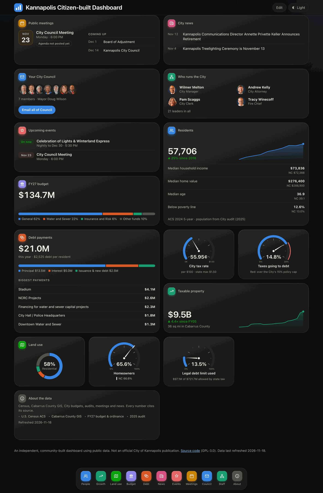

# Kannapolis Citizen-built Dashboard

An open-data dashboard for **Kannapolis, North Carolina**, built by a resident for residents: who lives here, how the city is growing, how land is zoned, how the budget and debt work, what's happening, and who to contact.

It's **one self-contained HTML file** built by a small Python script. No Node, no venv, nothing to install.



## Quick start

```bash
python3 etl/run_all.py          # fetch all data and build dist/index.html
open dist/index.html            # or double-click it
./serve.sh                      # view it on your phone too (same Wi-Fi)
```

- `python3 etl/run_all.py site`: rebuild the page only (instant, no downloads)
- `python3 etl/run_all.py meetings news events site`: refresh the time-sensitive widgets, then rebuild
- Steps: `budget census council meetings events news org zoning property site` (`property` takes 5–30 min; the county GIS server is slow)

**Requirements:** Python 3.10+ for the data steps (standard library only). Building and serving also work on macOS's built-in Python 3.9.

**Settings:** copy `.env.example` to `.env` (git-ignored).

| Setting | Purpose |
|---|---|
| `KDASH_CONTACT` | Your name and email, sent in the User-Agent of every data request so publishers know who is harvesting |
| `CENSUS_API_KEY` | Optional, [free](https://api.census.gov/data/key_signup.html); adds an income-over-time chart |

## Using the dashboard

The home screen is a grid of widget tiles. **Tap a tile, or an icon in the dock, to open the full widget in a window.** Links like `#budget` open a window directly.

**Edit** lets you:
- **Resize** tiles: S, M, L, XL. Bigger sizes show more detail; XL shows as L on phones.
- **Rearrange** tiles by dragging. On a phone, drag the ⠿ handle; with a keyboard, focus the handle and use the arrow keys.
- **Hide or restore** tiles.

Your layout is saved in your browser. While `./serve.sh` is running, **Save as default home page** writes it to `data/manual/home_layout.json`, the home page for every visitor once committed. **Reset layout** returns to the default.

## Testing on your phone

```bash
./serve.sh
```

It prints the address to open on your phone (for example `http://192.168.1.20:5180`). Each page load rebuilds first if anything in `site/` or `data/` changed, so **just reload the phone to see edits**.

`serve.sh` uses macOS's built-in, Apple-signed Python because the macOS firewall silently blocks phone connections to unsigned programs (Homebrew Python or Node). You can also AirDrop `dist/index.html` to the phone.

## Widgets and sources

| Widget | Source | Updated |
|---|---|---|
| Gauges | Derived from the budget, audit and Census data below | Automatic |
| People | U.S. Census ACS 5-year via [Census Reporter](https://censusreporter.org/profiles/16000US3735200-kannapolis-nc/) | Automatic |
| Growth & property | [Cabarrus County GIS open data](https://location.cabarruscounty.us/arcgisservices/rest/services/OpenData) (current and yearly snapshots) | Automatic |
| Land use & zoning | Cabarrus County GIS, *Kannapolis Zoning* | Automatic |
| Budget & debt | City budget ordinances, budget books and audited financial reports (PDFs) | **By hand**: [`data/manual/README.md`](data/manual/README.md) |
| Debt service | FY 2026–27 adopted budget, loan by loan, checked against the ordinance totals | **By hand**: `data/manual/debt_service_fy2027.csv` |
| City news | The City's [news page](https://www.kannapolisnc.gov/news) | Automatic, daily |
| Upcoming events | The City's [events calendar](https://www.kannapolisnc.gov/Community/Calendar) RSS feed; repeating events merged (meetings never are) | Automatic, daily |
| Public meetings | The City's [CivicClerk portal](https://kannapolisnc.portal.civicclerk.com) API, with agendas | Automatic, daily |
| City Council | [City Council page](https://www.kannapolisnc.gov/citycouncil) | **By hand**: `data/manual/council.csv`, photos in `site/photos/council/` |
| Who runs the City | The City's 2026 org chart and staff directory | **By hand**: `data/manual/org_chart.json`, photos in `site/photos/staff/` |

The news and meetings harvesters are adapted from [kspider](https://github.com/bradspry/kannapolis-news-wire).

**Coverage:** Kannapolis spans Cabarrus *and* Rowan counties. Property, growth and zoning cover the Cabarrus part only; Census and budget figures cover the whole city. Parcel data is published only as aggregates, with no owner names or individual parcels.

## Project layout

```
etl/               Python pipeline (standard library only)
  run_all.py       runs the steps; one failing source doesn't block the rest
  build_*.py       one per data source → data/generated/*.json
  build_site.py    inlines CSS, JS, data and photos → dist/index.html
  serve.py         Wi-Fi server with rebuild-on-reload (run via ./serve.sh)
data/manual/       hand-curated inputs, each row citing its source
data/generated/    pipeline output (committed, so the site rebuilds offline)
site/              index.html, style.css, js/ (os.js shell, tiles.js home screen, sections/ windows), photos/
dist/index.html    the finished dashboard (git-ignored; rebuild any time)
```

Only the chart and map libraries (Observable Plot and MapLibre, pinned versions from jsDelivr) and the map tiles (OpenFreeMap) load from the internet.

## Deploying (GitHub Pages)

In the repository, open **Settings → Pages** and set **Source: GitHub Actions**. Then:
- **Deploy site** builds and publishes on every push to `main`.
- **Refresh data** runs weekly (meetings, news and events daily), commits new data, and triggers a redeploy.

Add `KDASH_CONTACT` (and `CENSUS_API_KEY`, if used) under **Settings → Secrets and variables → Actions**.

## License

[GNU General Public License v3.0](LICENSE). You may use, change and share this code; if you distribute a modified version, it must also be GPL-3.0.

The data belongs to its publishers (the City of Kannapolis, Cabarrus County, the U.S. Census Bureau and others), and photos are courtesy of the City of Kannapolis. **This is an independent community project, not an official City of Kannapolis product.**
